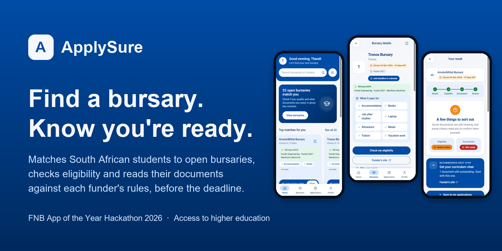

<p align="center"></p>

# ApplySure

**Find a bursary. Know you're ready.** ApplySure is a mobile-first web app for South African students. It matches them to open bursaries and checks whether they qualify. It also reads their documents against each funder's rules, so no application is lost to paperwork before the deadline.

Built by team **#RAG2Riches** for the **FNB App of the Year Hackathon 2026**, problem statement *Access to higher education*.

**Live app:** https://apply-sure-e22x.vercel.app. Judges: the demo login is on the "Demo account" slide of our submission deck.

> The first visit can take up to a minute while the free API server wakes up.

## What it does

| | |
|---|---|
| **Personalised matches** | A three-tap setup (field, funding year, course) ranks 47 open bursaries, NSFAS included. Each comes with plain reasons such as *"Funds Engineering · Funds 2027 · Mentions electrical"*, what it pays for, and a deadline countdown. |
| **Readiness check** | A two-minute check that reports **eligibility** and **document completeness** separately, then gives one clear next step. |
| **Document check** | Upload a PDF or a phone photo. The app reads ID numbers (checksum-validated), names, issue and expiry dates, marks and household income, and checks them against the bursary's rules. Anything unreadable or ambiguous (such as two different averages) becomes *needs confirmation*, never a false pass. No documents to hand? **Use sample documents** attaches a fictional student's set, clearly marked SAMPLE. |
| **Your applications** | Checks, notes and saved bursaries are kept in your account. Deadlines export to your calendar with reminders a week and a day before. |
| **Privacy built in** | Documents are read in memory and never stored. Each student can only reach their own data. *Download my data* and *Delete my account* are in the app. |

## How it works

```
Phone browser ── React + TypeScript (Vercel)
      │  /api (same-origin proxy)
      ▼
ApplySure API ── FastAPI on Render (Docker)
      │   rules engine · PDF reader · offline OCR (RapidOCR) · malware scan (ClamAV) · rate limits
      │   files read in memory, then discarded
      ▼
Supabase ─────── sign-in (ES256 tokens) · Postgres with row-level security

Bursary ingestion ── public listings → free-tier AI (Gemini / OpenRouter) or a page-layout reader
                     → validated rules JSON → human review (python -m app.review)
```

- **Eligibility vs completeness:** two separate results everywhere. A "pass" means the evidence met a modelled rule. It never means the funder accepted the application or that a document is genuine.
- **Untrusted AI output:** bursary pages are read by AI, but the AI's answer is mapped onto a fixed vocabulary of document types and rules, so nothing it invents becomes a check.
- **Bounded processing:** PDF reading and OCR run in isolated child processes with time limits.

## Tech stack

**Frontend:** React 19, TypeScript, Vite, React Router, Supabase JS, Vitest
**Backend:** Python 3.12, FastAPI, Pydantic, PyJWT, pypdf, RapidOCR (ONNX), pytest
**Data and hosting:** Supabase (Auth and Postgres with RLS), Vercel, Render, Docker, ClamAV

## Run it locally

Prerequisites: Node 20.19+ or 22.12+, Python 3.12+, and a Supabase project with asymmetric (ES256/RS256) JWT signing keys.

```powershell
# 1. Database: run supabase/migrations/0001_applications_and_saved.sql once in the Supabase SQL Editor.

# 2. API
cd backend
Copy-Item .env.example .env        # set SUPABASE_URL; for local use set ALLOW_UNSCANNED_UPLOADS=true
python -m venv .venv
.\.venv\Scripts\python.exe -m pip install -r requirements.lock
.\.venv\Scripts\python.exe -m uvicorn app.main:app --reload

# 3. Web app (second terminal)
cd frontend
Copy-Item .env.example .env        # set VITE_SUPABASE_URL and VITE_SUPABASE_PUBLISHABLE_KEY
npm ci
npm run dev                        # http://localhost:5173 (proxies /api to :8000)
```

In Supabase → Authentication → URL Configuration, add `http://localhost:5173` and `http://localhost:5173/**`.

## Bursary data

```powershell
cd backend
.\.venv\Scripts\python.exe -m app.ingest --closing --limit 40      # bursaries closing in the next months
.\.venv\Scripts\python.exe -m app.ingest --faculty engineering     # one faculty's listing
.\.venv\Scripts\python.exe -m app.review list                      # drafts waiting for a person
.\.venv\Scripts\python.exe -m app.review approve <id>              # after checking the funder's page
```

The job respects the site's 30-second crawl delay and skips bursaries that have closed. Set `GEMINI_API_KEY`, `GROQ_API_KEY` or `OPENROUTER_API_KEY` in `backend/.env`. When every AI provider is out of quota, it reads the page layout instead.

## Deploy

See **[DEPLOY.md](DEPLOY.md)**:
- a free hackathon setup (Vercel and the `render.yaml` blueprint);
- a production setup (`docker-compose.yml` with ClamAV, where `ENVIRONMENT=production` refuses unscanned uploads).

## Security and privacy

- Every API route needs a verified Supabase token (signature, issuer, audience, expiry and role), and is rate-limited per user.
- Uploads are validated by their real file type, size-capped, malware-scanned, held in memory only and discarded.
- Row-level security restricts every saved record to its owner. Account deletion cascades to all of the owner's data.
- Logs hold the path, status and request ID only, never document text or tokens.
- No secrets are in the browser bundle. `npm run preflight` fails the build on service keys or placeholder text.
- [Privacy notice](https://apply-sure-e22x.vercel.app/privacy) and [terms](https://apply-sure-e22x.vercel.app/terms) explain the POPIA rights in plain language.

## Tests

```powershell
cd backend;  .\.venv\Scripts\python.exe -m pytest -q     # 52 tests: rules, uploads, OCR, ingestion, API
cd frontend; npm test; npm run build; npm run preflight    # 20 tests, plus the production build and pre-launch checks
```

CI runs all of these, plus a Docker build of the API, on every push.

## Project layout

```
frontend/   React app: pages, components, check logic, Supabase client
backend/    FastAPI app: routes, rules engine, document reading, ingestion, review tool, tests
supabase/   SQL migrations (tables, row-level security, account deletion)
render.yaml, docker-compose.yml, DEPLOY.md   hosting
api-contract.md, database-design.md          API and data design notes
```

## Disclaimer

ApplySure helps students prepare. It is not a funder, does not decide who is funded, and does not verify that documents are genuine. Bursary listings are gathered from public sources and should be confirmed on the funder's official page.
